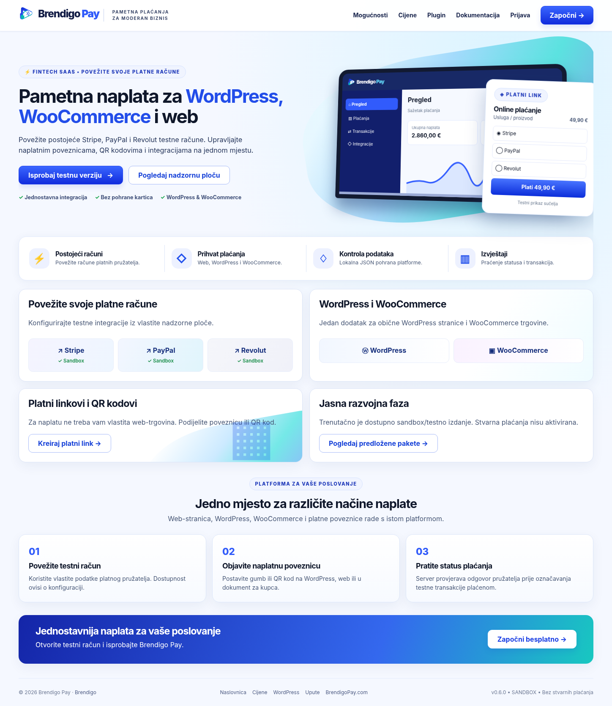
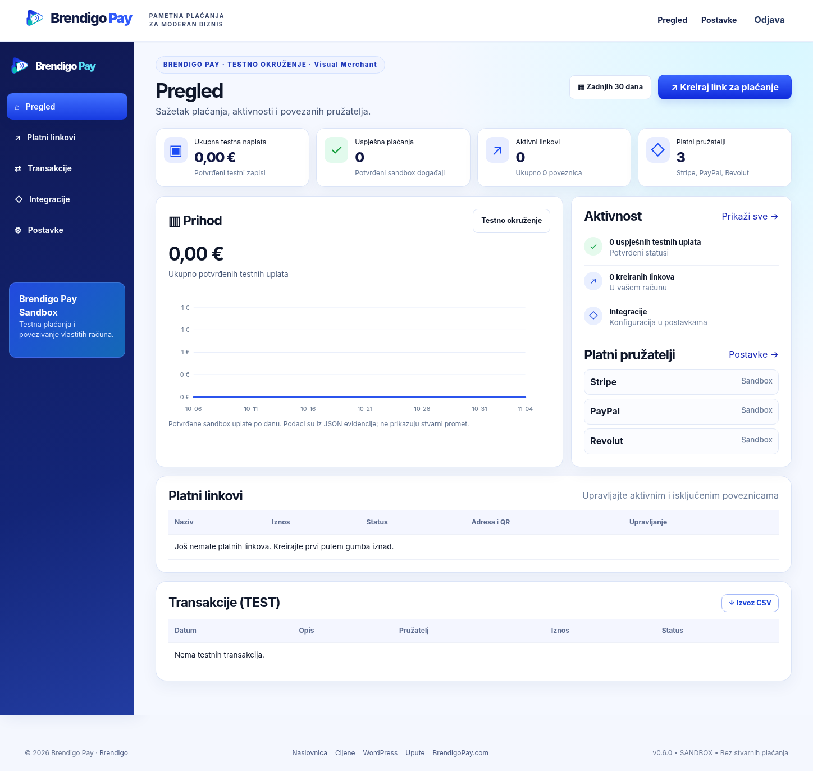
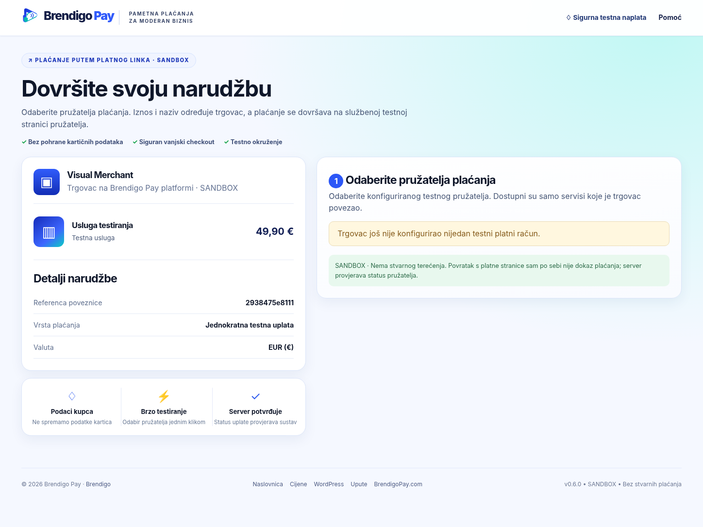
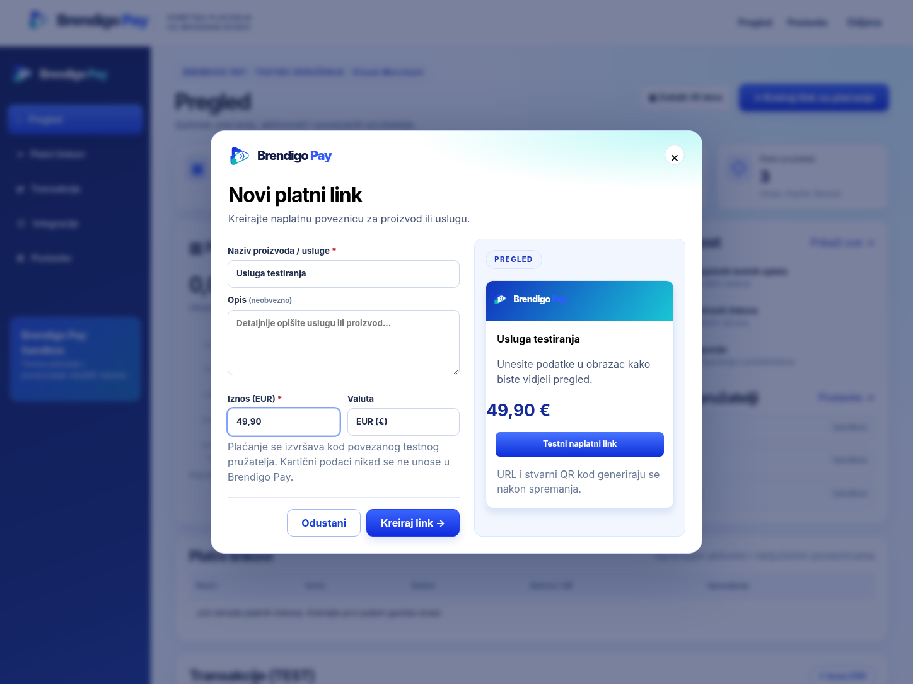
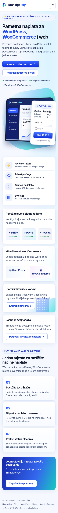
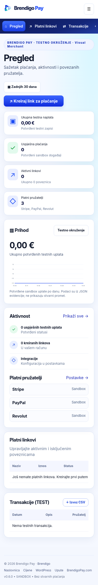
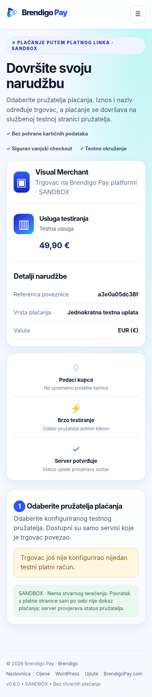
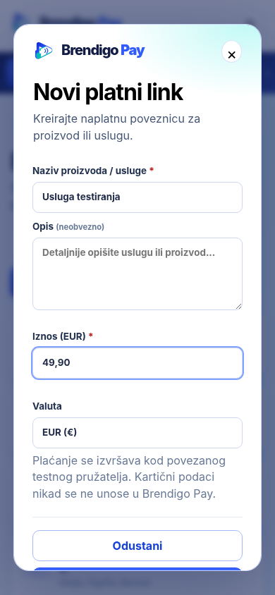
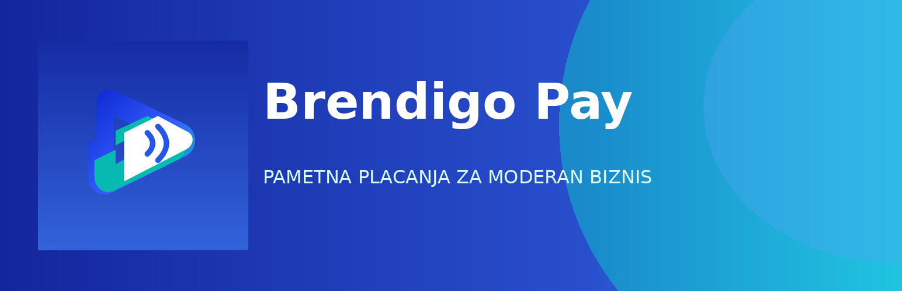

<div align="center">
  
  <h1>Brendigo Pay</h1>
  <p><strong>Pametna plaćanja za moderan biznis</strong></p>
  <p>Jedna platforma za naplatne poveznice, QR kodove, WordPress i WooCommerce.</p>
  <p>
    <a href="https://brendigopay.com">BrendigoPay.com</a> ·
    <a href="https://brendigo.com">Brendigo</a> ·
    <a href="https://github.com/bren-wp/Brendigo-Pay/releases">Izdanja</a> ·
    <a href="docs/API.md">API dokumentacija</a>
  </p>
  <p>
    
    <strong>v0.8.3 · SANDBOX · bez stvarnih uplata</strong>
  </p>
</div>

> **RAZVOJNO IZDANJE v0.8.3 — SANDBOX**. Brendigo Pay trenutno **ne podržava stvarne uplate**. Stripe TEST, PayPal Sandbox i Revolut Sandbox adapteri nisu potvrđeni u punim vanjskim end-to-end testovima. Ne unositi produkcijske tajne ključeve i ne postavljati kao aktivno sredstvo naplate. Izrada vizualnog sučelja prema referencama **ne znači potvrđenu pixel-by-pixel 1:1 podudarnost**.

## Sinkronizirani WordPress i web-paneli (v0.8.3)

Platforma prikazuje status pojedine instalacije, verziju dodatka i vrijeme zadnjeg sigurnog kontakta. WordPress po rasporedu (WP-Cron, svakih sat vremena) šalje poslužiteljski zahtjev potpisan vlastitim **domenski ograničenim API tokenom** te ID-jem instalacije. Platforma provjerava isteklu/suspendiranu pretplatu, vlasnika domene, licenciju i instalaciju.

**WooCommerce Classic i Blocks** ne nude Brendigo Pay ako posljednja uspješna sinkronizacija nije potvrđena tijekom prethodna dva sata ili je platforma odbila zahtjev. Administrator može odabrati „Sinkroniziraj sada“ u WP postavkama; status uključuje Start/Business/Pro, iskorištene domene i datum isteka. Operator može suspendirati plaćeni paket iz `/admin` te tako odmah blokirati pristup API-ju.

Ovo je još uvijek **SANDBOX**. Nakon deploya treba potvrditi produkcijske platne pružatelje, automatiziranu naplatu paketa, identitet trgovca, domensku vlasničku provjeru, WordPress/WooCommerce E2E te regulatornu usklađenost. Snimke u README-u odnose se na stvarni raniji UI, ali ne jamče vizualnu 1:1 identičnost svih referenci.

## Tri plaćena paketa, licence po web-stranici (v0.8.2)

| Paket | Predložena cijena / mj | Dopuštene domene |
|---|---:|---:|
| **Start** | 19,90 € | 1 |
| **Business** | 49,90 € | 5 |
| **Pro** | 99,90 € | 25 |

**Nema besplatnog paketa.** Registracija samo stvara račun i odabire paket, ne potvrđuje uplatu. Budući da produkcijska naplata pretplate nije integrirana, **operator ručno potvrđuje postojeću uplatu i aktivira paket**. Novi korisnici bez aktivirane licence ne mogu koristiti platformu kao naplatni servis. Izdavanje 1/5/25 licenci se provjerava pod zaključavanjem JSON pohrane na serveru.

**Povezivanje:**
1. Trgovac registrira račun i bira Start, Business ili Pro.
2. Administrator nakon neovisno verificirane uplate aktivira paket i datum isteka u `/admin`.
3. Trgovac u `/sites` unosi HTTPS domenu WordPressa, npr. `https://trgovina.hr`, pa dobiva **jednokratni licencni ključ**.
4. U WordPressu otvara **Brendigo Pay → Postavke**, sprema URL platforme i unosi licencni ključ.
5. Dodatak šalje licenciju i ID instalacije platformi; nakon provjere vraća se zaseban **`bp_test_` API token**, ograničen na tu domenu i instalaciju.
6. Korisnički panel prikazuje iskorištene licence i omogućuje rotaciju ili uklanjanje domene. Rotacija opoziva prethodni API ključ.

**Sigurnosna ograničenja:** licencije su u JSON pohrani samo kao SHA-256 sažeci. Za odobravanje paketa obavezna je konfiguracija `admin_user_ids` u privatnoj `platform/config.php`. Aktivacija još ne provodi neovisnu DNS/HTTP potvrdu vlasništva domene, pa ne treba uključivati produkcijske uplate prije njezine implementacije. WordPress standardno koristi vlastitu bazu za opcije dodatka; web-platforma koristi samo `storage/data` JSON.

[Detaljna dokumentacija o paketima i licenci](docs/PAID-PLANS-LICENSES.md).

## Hitni ispravak WooCommerce fatal error (v0.8.2)

Ispravljen je konflikt naslijeđenog svojstva `$settings` između `BP_Pay_Blocks` i službene WooCommerce `AbstractPaymentMethodType` klase. U ranijoj verziji mogao je izazvati **kritičnu PHP grešku** kada WordPress pokrene integraciju Checkout Blocks. Novu verziju možete instalirati preko postojeće iz odjeljka **Dodaci → Dodaj novi → Prenesi dodatak** ili zamijeniti mapu dodatka; **ne brišite pohranjene postavke i nemojte mijenjati postojeće API ključeve**. Dodatne upute za oporavak: [docs/WORDPRESS-CRITICAL-ERROR-0.8.2.md](docs/WORDPRESS-CRITICAL-ERROR-0.8.2.md).

## Doživite Brendigo Pay

Prikazujemo **stvarne snimke lokalno izvršene web-platforme**, nastale automatiziranim renderiranjem njezina HTML/CSS/JS sučelja. Ovo **nisu** generirane dizajnerske reference, ali **nisu** ni potvrda rada javnog produkcijskog servisa.

| Web naslovnica — desktop | Korisnička nadzorna ploča — desktop |
|:--:|:--:|
| [](docs/screenshots/web-home-desktop.png) | [](docs/screenshots/user-dashboard-desktop.png) |
| Naplatna poveznica — desktop | Novi platni link — desktop |
| [](docs/screenshots/sandbox-checkout-desktop.png) | [](docs/screenshots/new-payment-link-desktop.png) |

<details>
<summary><strong>Mobilne snimke aplikacije (stvarni lokalni prikaz)</strong></summary>

| Naslovnica | Nadzorna ploča | Naplata | Novi link |
|:--:|:--:|:--:|:--:|
| [](docs/screenshots/web-home-mobile.png) | [](docs/screenshots/user-dashboard-mobile.png) | [](docs/screenshots/sandbox-checkout-mobile.png) | [](docs/screenshots/new-payment-link-mobile.png) |

</details>

### WordPress i WooCommerce — zaseban vizualni identitet

<div align="center">
  
  <p></p>
</div>

**Brendigo Pay for WordPress** radi na običnim WordPress stranicama pomoću shortcoda i četiriju Gutenberg blokova, a uz WooCommerce nudi zaseban sandbox gateway za klasični Checkout i Checkout Block. Obrada i potvrda plaćanja odvijaju se preko poslužiteljskog API-ja i platnih pružatelja.

> **Stvarne snimke WP administracije, Gutenberga i WooCommerce checkouta još nisu snimljene u kompletnoj WordPress/WooCommerce instalaciji.** Grafike iz `design/references/` ostaju **ciljni mockupovi**, a ne stvarne snimke dodatka. Ne zamjenjujemo ih lažno prikazanim screenshotovima. [Protokol snimanja i provjere 1:1](docs/WORDPRESS-PIXEL-CHECKLIST.md).

## Jedno mjesto za različite načine naplate

| Modul | Što je dostupno u v0.8.2 |
|---|---|
| 🖥️ Web | Registracija, prijava, korisnička nadzorna ploča, izvještaji u testnom načinu |
| 🔗 Naplatne poveznice | Kreiranje, aktivacija/deaktivacija, javni URL, iznos u EUR |
| ▦ QR kod | Lokalno generiran QR za HTTPS naplatnu poveznicu |
| ⓦ WordPress | Gutenberg blokovi, kratki kod, kartice i naplatni gumbi |
| 🛒 WooCommerce | Klasični Checkout i Checkout Block; HPOS kroz WooCommerce CRUD |
| ◇ Pružatelji | Stripe TEST, PayPal Sandbox, Revolut Sandbox — zahtijevaju integracijsko testiranje |
| 🗃️ Pohrana | Privatne pojedinačne JSON datoteke u `platform/storage/data/` |
| 🛡️ Sigurnost | CSRF, HTTPS pravila, hashirani ključevi, libsodium, JWT se ne koristi, potpisani webhookovi |
| 📋 Pregled koda | Sigurnosni nalazi i dead-code revizija dokumentirani, a otvoreni rizici navedeni |

### Kako je Brendigo Pay organiziran

```text
WordPress stranica / WooCommerce trgovina
               │
      Brendigo Pay dodatak
               │  HTTPS REST API + testni ključ
               ▼
     Brendigo Pay web-platforma
      ├── trgovci / linkovi
      ├── transakcije / JSON
      ├── sandbox adapteri
      └── potpisani webhookovi
               │
        Stripe / PayPal / Revolut
        (isključivo TEST/SANDBOX)
```

**Bez zasebnog SQL-a za platformu:** `platform/storage/data/` čuva svakog korisnika, link i transakciju kao JSON zapis izvan javnog document roota. **WordPress i WooCommerce i dalje koriste vlastitu standardnu SQL bazu.** Instalacija na istu domenu ne znači dijeljenje administratorskih lozinki.

## Brz početak

### 1. Samostalna platforma

Preduvjeti: PHP 8.2+, proširenja `curl`, `sodium`, `openssl`, `json`, i `mbstring`; konfiguriran HTTPS i web root na `platform/public` za javne instalacije.

```bash
cd platform
php bin/setup.php http://127.0.0.1:8080
php -S 127.0.0.1:8080 router.php
```

Lokalni HTTP dopušten je samo za `localhost`/`127.0.0.1`. Za javni server koristi HTTPS i zaseban web root. Datoteke `config.php` i `storage/data/` ne smiju biti javno dostupne.

### 2. WordPress dodatak

1. Preuzmi `brendigo-pay-wordpress-0.8.2.zip` s [GitHub izdanja](https://github.com/bren-wp/Brendigo-Pay/releases).
2. U WordPressu otvori **Dodaci → Dodaj novi → Prenesi dodatak**.
3. U **Brendigo Pay → Postavke** unesi HTTPS adresu platforme i vlastiti `bp_test_...` ključ.
4. Provjeri vezu. Na platformi konfiguriraj podržane sandbox pružatelje.
5. U Gutenberg editoru odaberi stvarni naplatni link ili upotrijebi kratki kod:

```text
[brendigo_pay id="24_HEKSADECIMALNA_ZNAKA" layout="card" show_qr="yes"]
```

Za WooCommerce dodatak uključi **WooCommerce → Postavke → Plaćanja → Brendigo Pay (SANDBOX)**. Vrijednost narudžbe, PDV i dostavu izračunava WooCommerce — ne referentna slika.

## Približavanje 1:1 dizajnu

Svih 10 referenci nalaze se u `design/references/`. One su **dizajnerski ciljevi** za web, dashboard, Gutenberg, WooCommerce i WordPress admin — nisu snimke produkcijske aplikacije.

- [Pixel parity specifikacija](docs/PIXEL-PARITY.md)
- [WooCommerce + Gutenberg + WordPress provjera po elementima](docs/WORDPRESS-PIXEL-CHECKLIST.md)
- [Vizualno testiranje i ograničenja](docs/VISUAL-QA.md)
- [Mjerenje razlika na pravim screenshotovima](scripts/visual_audit_wp.py)

Mjere se razmaci, položaji, tipografija, linije, gumbi i interakcije na jednakim rezolucijama; bez usporedbe stvarnih screenshotova **ne tvrdimo da je rezultat 1:1**.

## Sigurnost i privatnost

Kartični podaci ne prikupljaju se ni ne pohranjuju u Brendigo Pay. Plaćanje se dovršava na stranici pružatelja, a status treba potvrditi na poslužitelju. Lozinke platforme čuvaju se Argon2id hashom; povezani sandbox ključevi šifrirani su lokalno. JSON storage koristi atomske upise i zaključavanje kritičnih operacija.

**Audit nije produkcijska sigurnosna certifikacija.** Pročitaj [nalaze sigurnosnog audita](docs/SECURITY-AUDIT-0.8.0.md), [dead-code audit](docs/DEAD-CODE-AUDIT-0.8.0.md) i [otvorena sigurnosna ograničenja](docs/SECURITY.md). Za javno korištenje potrebni su vanjski pen-test, testni provider računi, provjera PSD2/PCI/GDPR obveza i stvarni WooCommerce integracijski testovi.

## Testiranje i izdanja

```bash
bash tests/run-all.sh
python3 scripts/package_release.py --output dist
```

Automatske provjere obuhvaćaju PHP lint, JSON i HTTP smoke testove, provjere sigurnosnih politika, offline simulirane WooCommerce gateway scenarije i ZIP integritet. Browser vizualni testovi provode se zasebno. U `dist/` nastaju instalacijski paketi za platformu, WordPress i kompletan izvorni kod.

## Brending i licenca

**Proizvod:** Brendigo Pay · **Autor:** Brendigo · **Službena stranica:** https://brendigopay.com · **Stranica autora:** https://brendigo.com

WordPress Plugin URI, Author URI, Contributors: `brendigo`, Text Domain: `brendigo-pay`. GPL-2.0-or-later, uz poštivanje licencija uključenih resursa u `docs/THIRD_PARTY_NOTICES.md`. Ne mijenjati uvjete ni atribucije autorskih prava trećih strana bez prava na to.

---

*Brendigo Pay • razvijeno pod brendom Brendigo • razvojno SANDBOX izdanje, bez stvarnih plaćanja.*
